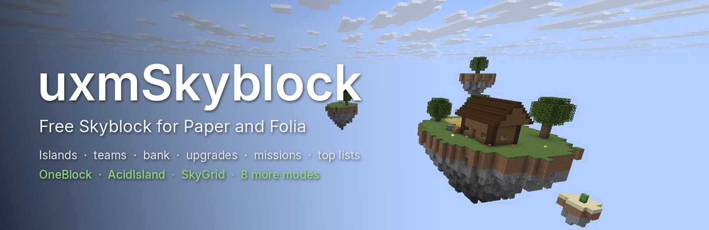
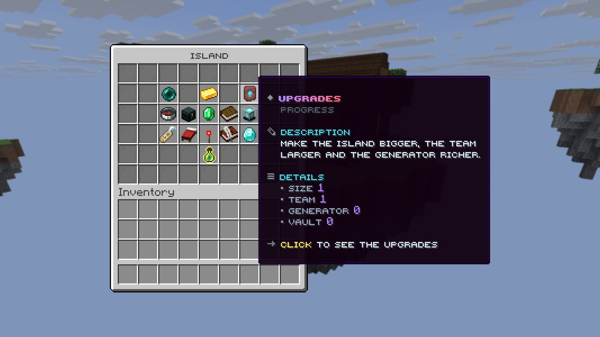

<p align="center">
  
</p>

<p align="center">
  <a href="https://github.com/UXPLIMA/uxm-skyblock/releases/latest"></a>
  <a href="https://github.com/UXPLIMA/uxm-skyblock/actions/workflows/ci.yml"></a>
  
  
</p>

**uxmSkyblock** is a free Skyblock plugin for Paper and Folia. A player starts an island in one of twelve modes,
grows it with a team, spends from a shared bank on upgrades, and climbs the leaderboards. Every window, every
line a player reads and every price is a plain file you can change, in seven languages.

One jar, nothing else required. Vault, PlaceholderAPI, Floodgate and the web maps are used when they are there.

**[Download](https://github.com/UXPLIMA/uxm-skyblock/releases/latest)** ·
**[Manual](https://docs.uxplima.com/minecraft/plugins/uxmskyblock)** ·
**[Report a bug](https://github.com/UXPLIMA/uxm-skyblock/issues)**

## What it does

### Twelve ways to start

The classic island with its oak tree, plus eleven modes: **OneBlock**, **ChunkBlock**, **AcidIsland**,
**CaveBlock**, **SkyGrid**, **Boxed**, **Poseidon**, **StrangerRealms**, **Brix**, **Parkour** and **TradeWinds**.
`/is create` opens a window with every mode you offer; a right click shows the island before the player picks it.
Boxed and StrangerRealms need Paper; the rest run on Folia too.

### An island that grows



- **Bank:** money and experience every member shares. Upgrades, the island shop and boosters are paid from it.
- **Upgrades:** a bigger island, a larger team, a richer generator, more vault pages.
- **Missions and boosters:** goals with rewards, and faster spawners, crops and experience for a while.
- **Island level:** counted from the value of every placed block.

### A team, not just an owner

Invites, kicks, bans and trusted visitors. The owner shapes each role permission by permission and decides what
visitors may do on the island. Homes, warps, a guestbook, ratings, alliances, an activity log and player trades
come with it.

### Leaderboards anywhere

The best islands by level, worth and bank balance, ranked under their owners. Show them on a hologram, a
scoreboard or a sign with `%uxmskyblock_top_level_alltime_1_name%` and the other placeholders. Seasons pay the
best islands at the end of each round and start the race again.

### Your words, your windows

Every window is a file under `menus/`. Every line a player reads is in `messages/`, in English, Turkish, German,
Spanish, French, Portuguese and Russian. A player picks a language with `/is lang`.

### Built to run for years

SQLite out of the box; MySQL, MariaDB and PostgreSQL with one block in `config.conf`. Dated copies of your config
are kept in `backups/`, and a new release adds its keys without touching yours. `/is doctor` lists what the
server is missing, such as an economy for the bank or a world a mode needs.

## Install

1. Download `uxmSkyblock-<version>.jar` from the [latest release](https://github.com/UXPLIMA/uxm-skyblock/releases/latest)
   and check it against `SHA256SUMS`.
2. Put it in `plugins/`.
3. Give the island world the plugin's generator in `bukkit.yml` before the world is first made:

   ```yaml
   worlds:
     world:
       generator: uxmSkyblock
   ```

4. Start the server and run `/is create`.

Paper or Folia 26.2 or later, and Java 25. The files the plugin writes are listed in
[docs/user/reference.md](docs/user/reference.md).

## Build

```sh
./gradlew build       # format check, static analysis, the shaded jar and its checks
./gradlew runServer   # a local Paper server with the plugin
```

More in [docs/README.md](docs/README.md). Every picture on this page was taken in game on a test server.

By [UXPLIMA](https://github.com/UXPLIMA) · GPL-3.0
